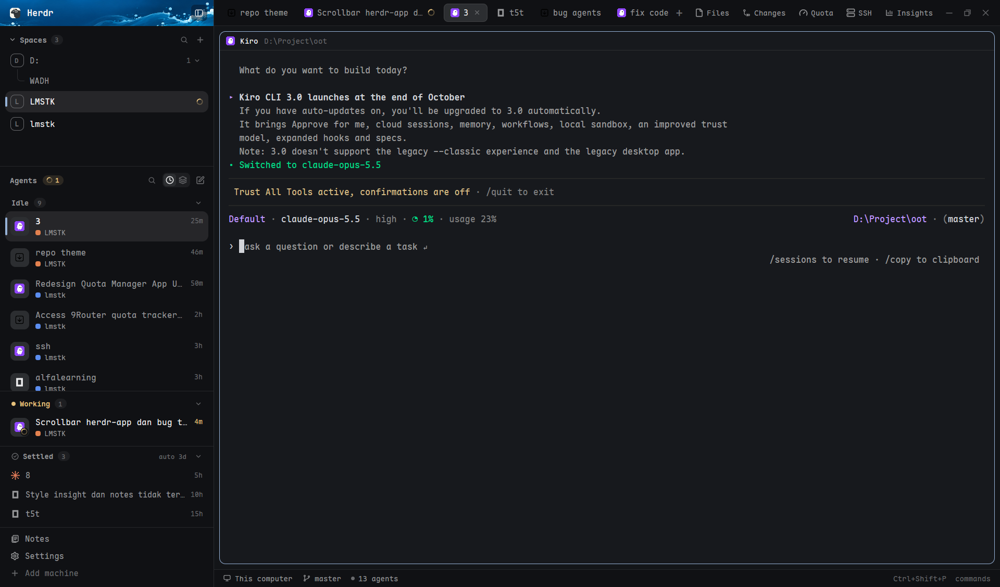

# genz

**A Herdr layout for people who run a lot of agents.** One calm sidebar with your spaces, a card-style agents list, and a **Settled** shelf (the "put it away" idea from T3 Code) that tidies finished agents for you.



> Bahasa Indonesia ada di bagian bawah.

## Highlights

- **Settled shelf.** Hover a finished agent and press the archive icon to put it away. It leaves the list and waits on a slim shelf at the bottom of the sidebar. An agent the layout can start again (Claude, Kiro, OpenCode, CodeBuddy, Codex on this machine) is **parked** at once: settling alone would keep it running, and a Claude Code holds about 500 MB. Others (another machine, no known resume command) show the circle-check instead and are only settled.
- **Auto-settle after 3 idle days.** Agents that have been idle for 3 days (the default) settle themselves. Click the `auto 3d` pill on the shelf header to step through 1d, 3d, 7d, 14d or off.
- **Comes back by itself.** A settled agent returns to the list when it starts working or needs you again, or when it finishes a new turn. Looking at it doesn't bring it back.
- **Park: free the memory, keep the place.** A settled agent keeps running and keeps its memory. Press the archive icon on its shelf row (or let the `park` pill do it: 1d, 7d, 14d, 30d after an agent auto-settled, or off) and the agent is closed but stays on the shelf, dimmed. Click it to start it again with the agent's own resume command, in its old space and folder. Works for Claude, Kiro, OpenCode, CodeBuddy and Codex. Idle ages come from the core's own `status_ms`, so an agent that has been idle for a week shows `7d` even if the layout was installed today.
- **Spaces or Agents, one at a time.** A `Spaces | Agents` switch at the top of the sidebar flips between the two lists; the Agents side keeps its needs-you and working counts on the switch, so you see them from Spaces too.
- **No scrollbars in the sidebar.** Spaces and Agents still scroll with the wheel, they just don't draw a bar.
- **Agents as cards.** Program icon with a state badge (spinner, dot), title, project and branch, time since the last change. Sections: Needs you, Done, Working (docked tray), Idle. Pin, settle and close sit on the card's hover.
- **Spaces with worktrees.** Colored avatars, repo and branch tails (`↑2 ↓1`), worktrees nested under their repo, machine groups when you use ssh machines.
- **Tabs that name themselves** after the agent's session title (never touching tabs you named), plus Files, Changes, Quota, SSH, Insights and Poké Ball buttons folded behind one chevron (only the ones that are on show until you unfold them).
- Photo header, bordered pane cards, status bar. Everything uses theme colors, so any Herdr theme works.

## What's in this repo

```
genz/
├─ layouts/genz.json            the layout
├─ layouts/genz-preview.svg     the picture Herdr's settings screen shows
├─ backgrounds/ocean-header.png header art
├─ keys.json                    keys the mods expect (merge it, don't replace yours)
├─ mods/
│  ├─ genz-chrome/   brand row + footer
│  ├─ genz-spaces/   spaces list
│  ├─ genz-agents/   agents list + Settled shelf
│  ├─ genz-tabs/     tab bar
│  ├─ projects/      helper: projects, worktrees, new-agent flow, menus, peek
│  ├─ projects-ui/   helper: the projects mod's dialogs and pickers
│  ├─ quota/         helper: 9Router quota panel
│  ├─ apple-notes/   helper: notes window
│  ├─ insights/      helper: usage analytics tab
│  ├─ ssh-hosts/     helper: SSH host manager tab
│  └─ pokemon-agents/ a strip where each agent roams as a pixel Pokémon: it walks and shows off moves while its agent works, hops when it needs you, celebrates when it's done, and sits about, then naps, when idle (Hide/Show on the strip folds it; Poké Ball button or ctrl-shift-y hides it; Pet or ctrl-shift-u lets one Pokémon float above the terminals)
├─ RECIPE.md                    a brief another agent can build the layout from
└─ preview.png
```

It also uses shipped Herdr mods (`pane`, `files`, `changes`, `workspace-status`, `workspace-chrome`, `menu`, `new-menu`, `worktree`, `toast`, `machine-add`), which every Herdr install already has.

## Install

**Easiest:** open Herdr and ask your agent:

> Add the layout from https://github.com/adittanu/genz

Herdr's `AGENTS.md` tells it to read `RECIPE.md` and every file, say what the mods touch, copy without overwriting, check each mod and switch to the layout.

**By hand** (Herdr home is `~/.config/herdr-app`; on Windows `C:\Users\<you>\.config\herdr-app`):

```sh
git clone https://github.com/adittanu/genz.git && cd genz
H=~/.config/herdr-app
mkdir -p "$H/backgrounds"
cp layouts/* "$H/layouts/"
cp backgrounds/* "$H/backgrounds/"
cp -rn mods/* "$H/mods/"          # -n: never overwrite a mod you already have
# merge keys.json into your own keys.json by hand
herdr-app check "$H/mods/genz-agents"   # repeat for each mod
herdr-app do layout.switch --name genz
```

PowerShell:

```powershell
git clone https://github.com/adittanu/genz.git; cd genz
$H = "$HOME\.config\herdr-app"
New-Item -ItemType Directory -Force "$H\backgrounds" | Out-Null
Copy-Item layouts\* "$H\layouts\" -Force
Copy-Item backgrounds\* "$H\backgrounds\" -Force
Get-ChildItem mods -Directory | Where-Object { -not (Test-Path "$H\mods\$($_.Name)") } | Copy-Item -Destination "$H\mods" -Recurse
herdr-app do layout.switch --name genz
```

If a mod name is already taken on your machine (`projects`, `quota`, `insights`...), rename the new folder and the `mod` names that point at it in `layouts/genz.json`, plus the `mods/<name>/` icon paths inside it.

Switch back any time with `ctrl-shift-l`. Remove it by deleting `layouts/genz.json` and the `mods/` folders you copied.

## Using Settled

| You do | What happens |
|---|---|
| Hover a finished agent, press the archive icon | It is parked: closed (memory freed) and kept on the shelf to resume. An agent that can't be resumed shows the circle-check and is only settled. |
| Click the shelf header | Fold or open the shelf (folded at first). |
| Hover a settled row, press the undo arrow | Back in the list, idle clock restarted. |
| Click `auto 3d` | Cycle the auto-settle time: 1d, 3d, 7d, 14d, off. |
| Hover a settled row, press the archive icon | **Park** it: the agent is closed (memory freed) and stays on the shelf, dimmed. |
| Click `park off` | Cycle how long an auto-settled agent keeps running before it is parked: 1d, 7d, 14d, 30d, off. |

Parked agents are stored in the mod's localStorage (`parked`): title, agent, folder, space, time. Resume runs `claude --continue`, `kiro-cli chat --resume`, `opencode --continue`, `codebuddy --continue` or `codex resume --last`. When other agents (running or parked) share the same folder, "the latest session" could be someone else's, so it opens the agent's own picker instead (`claude --resume`, `kiro-cli chat --resume-picker`, `codebuddy --resume`, `codex resume`). Herdr does not expose session ids, so that is the best a layout can do. Agents on other machines and agents without a known resume command can't be parked. (`settled=<ms>:<turn>`), so it survives restarts of the window, ends with the terminal, and every Herdr client sees the same shelf. The auto-settle time is the shared key `agents.settleDays` (`0` = off). The code is in `mods/genz-agents/main.js` (look for `// genz:`).

## Good to know before you install

- **Network:** only the Quota panel talks to a server, the 9Router URL you type in. Its password is saved as plain text in `data/9router-quota.json`.
- **Programs it runs:** `git`, `hc`, `curl` (Quota), `claude` (only if you use the branch-naming feature). On Windows the layout and its helper mods need no POSIX tools: folders, files and waits go through Herdr's `fs` and PowerShell. `sh` is only used to reach other ssh machines.
- **Files outside its folder:** Insights reads your Claude and Codex session logs (`~/.claude/projects`, `~/.codex/sessions`) to build usage numbers. The `projects` mod can start Claude to name branches, and writes under `data/projects/`.
- Tested on Herdr 0.1.x on Windows.

## Credits

Built on Herdr's `main` layout and shipped mods. The Settled idea follows T3 Code's sidebar.

---

## Bahasa Indonesia

**genz** adalah layout Herdr untuk yang menjalankan banyak agent. Sidebar-nya tenang, tanpa scrollbar, dengan daftar agent berbentuk kartu dan rak **Settled** ala T3 Code.

- Arahkan kursor ke agent yang sudah selesai, klik ikon arsip: agent masuk ke rak **Settled** di bawah sidebar dan langsung di-**park** (terminalnya ditutup supaya RAM-nya lepas, sekitar 500 MB untuk Claude Code), lalu bisa dilanjutkan lagi dari rak. Agent yang tidak bisa dilanjutkan (di mesin lain, atau tanpa perintah resume) memakai ikon centang-lingkaran dan hanya di-settle.
- Pil `park` di header rak mengatur kapan agent yang otomatis di-settle ditutup: 1d, 7d, 14d, 30d, atau mati.
- Agent yang **idle 3 hari** (default) otomatis masuk Settled. Klik pil `auto 3d` di header rak untuk ganti: 1d, 3d, 7d, 14d, atau mati.
- Agent keluar dari Settled sendiri kalau bekerja lagi, butuh kamu, atau menyelesaikan giliran baru.
- Lama idle dihitung dari stempel waktu core (`status_ms`), jadi agent yang sudah idle seminggu sebelum layout dipasang tetap terhitung seminggu.
- Pasang: minta agent kamu, "Add the layout from https://github.com/adittanu/genz", atau salin `layouts/`, `backgrounds/` dan `mods/` ke `~/.config/herdr-app` (lihat bagian Install di atas), lalu `herdr-app do layout.switch --name genz`.
- Catatan privasi: panel Quota memakai server 9Router milikmu (password disimpan plain text), dan Insights membaca log sesi Claude/Codex lokal.
