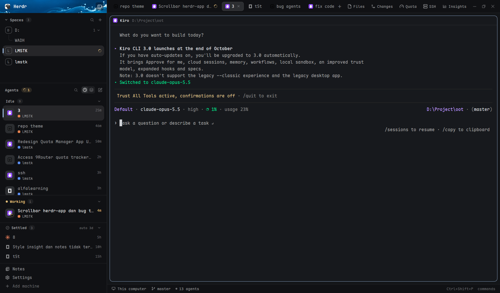

# genz

A Herdr layout built around one tall sidebar: a photo header, spaces, a card-style agents list with a Settled shelf that puts finished agents away (by hand, or by themselves after 3 idle days), and a footer. The work area on the right has pill tabs with Files, Changes, Quota, SSH and Insights buttons folded behind a chevron, bordered pane cards, and a status bar. There is no scrollbar anywhere in the sidebar.



## What you see

The window has no system title bar (`titlebar: "none"`; macOS lights at 12, 16). The tab bar and the brand row drag the window. The background is the theme's `canvas`. Fonts and sizes are not set by the layout: the person's `settings.json` decides them. The colors below are theme names.

**Left sidebar**, 342 px wide, `chrome` background, 1 px `border` divider on its right. It can't be dragged to resize (`resizable: false`, min 44, max 480). Under 160 px wide every sidebar mod draws a compact rail. Top to bottom:

1. **Brand row**, 42 px. Background image `backgrounds/ocean-header.png` (a blue ocean-wave photo, `cover`). On it: the Herdr logo (`frame/welcome/herdr.png`, 20 px, radius 5), the word "Herdr" (14 px, semibold, `foreground`), and at the right a 26 px square sidebar-toggle button (`#06162a8c`, `#06162acc` on hover, radius 6, `sidebar.svg` from `workspace-chrome`) that folds the sidebar to a 44 px rail and back.
2. **Spaces**, flexible (weight 0.67, min 34). Header 38 px: a chevron, "Spaces", a count pill, and at the right a search button and a + button. Clicking the chevron or title folds the whole block to a 38 px header (and the header then shows the active space's name at the right). Rows are 34 px (28 px for worktree children), radius 10, 8 px side padding. Each row has a 22 px radius-7 avatar with the space's first letter in white on one of six colors (`#22a99a`, `#e3814f`, `#5b8def`, `#8b7cf6`, `#3fae6a`, `#d9649a`, handed out least-used first and stored in shared `space.colors`). A space that isn't a saved project gets an outlined avatar with `dim` letter. The home space `~` shows a house tile and reads "Home". After the name, right-aligned and `dim` 11.5 px: repo and branch only when unusual (not `main`/`master`, not equal to the name), then `↑n` in `ansi2` and `↓n` in `ansi1`. A space with a working agent shows a small spinner at the row's end; blocked or done shows an 8 px dot in the `blocked` or `done` color. The active row has the `selected` background and a 3 px `accent` bar on its left edge. Worktree spaces are listed under their repo's row, joined by a thin curved line (`dim` at 33% alpha), with a count chip on the repo row ("2 ˅") that folds them. When another machine is known, each machine gets a foldable header row (this computer first), with its spaces indented under it. The list scrolls with the wheel and draws no scrollbar.
3. **Agents**, flexible (weight 1.73, min 90), `border` line on top. Header 38 px: "Agents" (12 px, semibold, `muted`); a `blocked`-tinted pill "N need you" when any agent is blocked; a `working`-tinted pill with a spinner and the count when any is working; then a search button, a two-button switch (clock = Priority, layers = Grouped by project; the chosen one has a `raised` background inside a `hover` track), and a pen button (new agent). The list is described below. It draws no scrollbar and scrolls with the wheel.
4. **Settled shelf**, docked at the very bottom of the agents block, 1 px `border` on top. Header 32 px: a circle-check icon, "Settled", a count pill, then at the right a small pill `auto 3d` (or `auto off`) and a chevron. Folded by default. Open, it shows slim 30 px rows (agent icon 14 px, title 12.5 px in `muted`, and at the right how long ago it was settled, e.g. `5h`), at most 10 and then a `N more` / `Show less` row, inside a box that stops at 230 px and scrolls. Empty and open it says "Nothing yet. Agents idle for 3d land here." The header also has a second pill, `park off` (or `park 7d`, `park 14d`, `park 30d`), left of the `auto` pill. Parked agents are listed after the settled ones on the same shelf: dim rows (75% opacity) with the agent icon, the title, and at the right an archive icon with the time since it was parked. The count pill counts settled plus parked.
5. **Footer**, 68 px, `chrome`, 1 px top border. Two 28 px rows (radius 8, 14 px icon): Notes and Settings (with a 6 px `accent` dot when an app update is ready). There is deliberately no "Add machine" row.

**Right side** (a column):

- **Tab bar**, 42 px, `chrome`, 1 px bottom border. Tab pills of the active space: 29 px high, radius 7, 12.8 px text, program icon 14 px, name (max 170 px, truncated). The active pill has the `raised` background, a `border` outline, and a close x. A tab with a working agent shows a spinner, blocked or done a 6 px dot. After the pills: a `+` button (opens the `new-menu` popup, 250 x 512), then the tool group Files, Changes, Quota, SSH, Insights and the Poké Ball (26 px high, radius 6, 12 px text, 14 px icon; `selected` background while their panel, tab or strip is showing), ending in a 26 px chevron button. The group starts folded: only the tools that are on show, as 26 px icon squares with their name as a tooltip, beside a `chevron-left`. Clicking the chevron unfolds it: every tool with its label (the Poké Ball stays an icon), and the chevron turns to `chevron-right` to fold it again. Folded or not is remembered in localStorage `tools-open`. On Windows the three window buttons (minimize, maximize/restore, close) are drawn at the far right with the `win-*.svg` icons.
- **Work body**, padded 8 px with an 8 px gap: the active tab's panes, each a card (radius 10, 1 px `border`, `background` fill, `accent` border while focused, 8 px gap between cards, the 30 px `pane` header always visible on top, a lone pane is framed too). Terminal padding 14 px vertical, 12 px horizontal. At its right the **side panel** (482 px, min 280, max 900), hidden at first, a stack of Files / Changes / Quota.
- **Status bar**, 28 px (`workspace-status`).
- A 0 px block hosting the `projects` mod in `host` view (it draws nothing; it keeps the projects data and answers `projects.*` commands).

## How it behaves

**Agent statuses in the agents list** (priority view; the agent is a card unless noted):

- **blocked** ("Needs you"): top section, label in the `blocked` color with a dot. The card has a faint `blocked` tint (14% alpha, 22% on hover), the icon tile has an 11 px `blocked` dot on its corner (2 px ring in the row's color), and the title line ends with a "Needs you" pill (`blocked` text on 15% tint).
- **done** (finished while you weren't looking): section "Done". Corner dot in `done`, title line ends with the word "Done" in `done`. Looking at it turns it idle in Herdr, but it stays in Done until you leave that card.
- **working**: section "Working", shown in a tray docked under the list with its own top rule, capped to 3 cards with a `N more` / `Show less` row. The tile shows a spinning arc (13 px circle on the corner), the title line ends with how long it has been working (`4m`).
- **idle**: section "Idle" (count pill, chevron). The title turns `muted` when it isn't focused, and the title line ends with how long it has been idle (`<1m`, `44m`, `3h`, `2d`), taken from the core's own state-change time.
- **settled**: not in any section above; on the Settled shelf.
- Pinned agents sit above all sections under a "Pinned" label, whatever their state.
- Sections are sorted by urgency (blocked > done > working > idle), then most recently changed. A parent counts as its most urgent sub-agent.
- In Grouped view the sections are the agent's project (or space) with a colored letter tile; the card's meta line then shows only the branch.

**Card.** The focused card has the `selected` background and a 3 px `accent` bar on its left. Meta line (16 px, `dim`): colored 8 px dot and the project or space name, a pin icon when pinned, a server icon when the agent is on another machine, then a branch line (`branch.svg` + branch name).

**Card hover.** The title line ends with small 13 px icon buttons: **pin** (always), **settle** (circle-check; not shown while the agent or any sub-agent is working or blocked, nor when pinned), **close** (x; only for idle agents). Settle turns green on hover, close turns `blocked`. Then the status text.

**Clicks.** Card or slim row: `pane.focus` that agent's pane. Right-click: `projects.agent-menu:<address>@<x>,<y>`. Pin: toggles the pin (kept in localStorage `pins`, pins of ended agents are dropped). Close: `pane.close` for the agent's pane; if it is the only pane of its space and other spaces exist, `space.close {confirmed: true}`; if it is the last space, a new tab is made first. Group headers and the Idle/Working headers fold their section. Claude sub-agents get a fold chip (bot icon + count) on the title line; with Claude sub-agents present a card starts folded.

**Settling.**

- Clicking the settle icon writes the label `settled=<now ms>:<turn>` on the agent's terminal (`hc label <address> settled=...`). The card moves to the Settled shelf at once (before the core answers). A failed write shows an error notification and the card stays.
- Every minute (and at the first render that has agents), any agent that is `idle`, not focused, not pinned, not already settled, with no working/blocked sub-agent, and idle for at least N days (default **3**) is settled the same way. "Idle for" is the core's `status_ms` from `hc get <address> --json` (asked once per local state change), so an agent idle for a week before the layout was installed counts as a week. The `auto 3d` pill on the shelf header steps through 1d, 3d, 7d, 14d, off and back (shared key `agents.settleDays`, `0` = off).
- A settled agent comes back by itself when it is working or blocked again, or when its terminal's `turn` is higher than the turn stored in the label. Looking at it or clicking its row does not bring it back. The row's hover buttons are "Bring back" (`undo.svg`; removes the label and restarts its idle clock) and Close.
- Settled agents are left out of the agent order used by `agent.next` / `agent.prev`.

**Keys** (put in `keys.json` under `global`): `ctrl-shift-a` `projects.switch` (agent switcher), `ctrl-shift-j` `projects.pick` (find project), `ctrl-shift-g` `projects.compose` (new agent), `ctrl-shift-enter` `projects.peek-go`, `ctrl-shift-q` `projects.peek-close`, `ctrl-shift-m` `mod.open:apple-notes`, and `ctrl-shift-b` `layout.toggle:sidebar` (hide or show the whole sidebar).

**Tabs.** An unnamed tab takes the title its agent reports (once; cleaned of agent names, paths and generic words, max 80 characters) via `tab.rename`. A tab the person named is never touched. Double-click a pill renames it; drag a pill onto another to move it; right-click opens the `menu` popup; the wheel over the bar runs `tab.prev` / `tab.next`. The side panel remembers, per space, whether it was closed or which panel it showed.

**Panel buttons.** Files / Changes / Quota: `layout.select {stack: "panel-body", child}` and `layout.show {id: "panel"}`; again hides. SSH: selects the space's tab named "SSH", else `tab.new {name: "SSH", mod: "ssh-hosts"}`. Insights: focuses the space's Insights tab, else `tab.new {name: "Insights", mod: "insights"}`.

## Built from

Files of one folder: `layouts/genz.json`, `layouts/genz-preview.svg`, `backgrounds/ocean-header.png`, `keys.json`, `mods/*`.

**Layout tree** (`layouts/genz.json`; root `preview: "layouts/genz-preview.svg"`, `background: "canvas"`, `terminal_padding: [14, 12]`, `divider: {width 1, color "border"}`, `titlebar: "none"`, `traffic_lights: [12, 16]`):

```
root row
├─ sidebar column  size px 342, min 44, max 480, background "chrome", resizable false
│  ├─ brand           block genz-chrome            px 42, window_drag, background {image ocean-header.png, cover}
│  ├─ sidebar-lists   column
│  │  ├─ spaces       block genz-spaces            weight 0.67, min 34
│  │  └─ agents       block genz-agents            weight 1.73, min 90
│  └─ sidebar-footer  block genz-chrome {footer: true}   px 68
└─ work column  resizable false
   ├─ tabs            block genz-tabs              px 42, window_drag
   ├─ work-body       row, padding 8, gap 8
   │  ├─ main         block {tab: "active", pane: {header {mod "pane", height 30, position "top", reveal "always"},
   │  │                background "background", border {1,"border"}, focus {1,"accent"}, radius 10, gap 8, lone true}}
   │  └─ panel        column px 482, min 280, max 900, hidden true
   │     └─ panel-body stack, active "changes": blocks files (mod files), changes (mod changes), quota (mod quota)
   ├─ pokemon-agents  block pokemon-agents         px 112, min 26, max 240
   ├─ status          block workspace-status       px 28
   └─ projects        block projects {view: "host"} px 0
```

**Mods** (each in `mods/<name>/`, `mod.json` has `"place": "none"`; icons referenced as `mods/<name>/x.svg`):

- `genz-chrome`: brand row and, with `props.footer`, the footer. Uses `window()`, `layout()`, `updates()`, `run("layout.resize", {id: "sidebar", px})`, shared `sidebar.width` / `sidebar.collapsed`. Opens `apple-notes` with `mod.open` and `app.settings`. Own icons: `notes.svg`, `filter.svg`.
- `genz-spaces`: the Spaces list. Uses `spaces()`, `panes()`, `machines()`, `hc(["machine","ls","--json"])`, `exec("git", ...)` (status --porcelain=v2 --branch, rev-parse), `watchFolder` on repos, `run("space.select" | "space.move" | "space.new" | "layout.resize")`, shared `space.colors` and `spaces.weight`. Reads the projects cache at `globalThis.__wranglerProjects.known.projects`. Calls `projects.pick`, `projects.new-menu`, `projects.space-menu:<id>|linked|main@x,y`, `projects.row-menu`, `projects.menu`, `projects.open`. Own icon: `house.svg`. Uses `overflow_y_scroll()` on an element with an `id` (no scrollbar).
- `genz-agents`: the Agents list and Settled shelf. Uses `agents()`, `terminals()` (`labels.settled`, `turn`, `parent`), `panes()`, `focused()`, `spaces()`, `hc(["label", ...])`, `hc(["get", address, "--json"])` (`status_ms`), `setAgentOrder`, `notify`, `exec` (git; `sh` to list Claude sub-agent files), `readTextFile`, `watchFolder`, shared `agents.sort` ("priority" | "grouped") and `agents.settleDays`, localStorage `pins`, `changed`, `revived`, `settled-open`, `checkouts`. Calls `pane.focus`, `pane.close`, `space.close`, `tab.new`, `projects.switch`, `projects.compose`, `projects.agent-menu`, `projects.peek:<address>`. Reads `globalThis.__wranglerProjects.memo` for branches. Own icons: `bot.svg`, `undo.svg`. Shipped icons used: `workspace-chrome/{spinner,circle-check,pin,pin-off,x,search,layers,clock,square-pen,branch,chevron-down,chevron-right,check,server}.svg`. The lists use `overflow_y_scroll()`, not `overflow_y_scrollbar()`.
- `genz-tabs`: the tab bar (see above). Own icons: `win-min.svg`, `win-max.svg`, `win-restore.svg`, `win-close.svg`, `chevron-left.svg`, `chevron-right.svg`. localStorage `panels`, `auto-titles`, `tools-open`. Opens overlays `menu` and `new-menu`; icons from `files`, `changes`, `quota`, `ssh-hosts`, `insights`, `pane`.
- Helper mods, bundled as they are and reached only through commands: `projects` (host: saved projects in `data/projects/projects.json`, git worktrees, new-agent flow, agent/space/row menus, peek; commands `projects.switch|pick|compose|peek|peek-go|peek-close|agent-menu|space-menu|row-menu|new-menu|menu|open|...`; it fills `globalThis.__wranglerProjects = {known, memo, ver}`), `projects-ui` (its dialogs, pickers, menus and peek bar), `quota` (a 9Router quota panel), `apple-notes` (a notes window), `insights` (usage analytics tab), `ssh-hosts` (ssh config tab), `pokemon-agents` (a strip above the status bar where each agent roams as a pixel Pokémon; click to focus its agent, right-click or `pokemon-agents.pick` to choose which one; folded to a 26 px bar with its own Hide / Show button (remembered in localStorage `folded`, old height in `open-height`, via `layout.resize`), or hidden entirely with the Poké Ball button. Its Pet button (or `pokemon-agents.pet`, ctrl-shift-u) lets one Pokémon out as a floating pet: `openOverlay {kind: "window", frame: "none", key: "pokemon-pet", keep: true, props: {pet: true}}`, shared `pokemon-agents.pet`; it follows the agent that needs you, then the one that finished, then one at work (the focused one first), then the focused one; the strip lets it out again when it starts; it redraws when agents change (no polling), and once more when it dozes off: an idle agent's Pokémon naps 30 s after the agent last changed state (`SLEEP_AFTER`, the strip's too; a `done` agent stays awake with its ✓ until it's looked at); drag to move, double-click to go to the agent, × to put it back. It doesn't walk around by itself, on purpose: a mod can't move an overlay, and every new overlay copy evaluates the module again and keeps that memory (about 200 KB a copy), so a pet that reopened itself a few px on at each step ran the shared mod runtime out of memory within minutes and broke every mod until Herdr restarted. The strip can also be hidden from the Poké Ball button in `genz-tabs` or `layout.toggle:pokemon-agents` (ctrl-shift-y), and it does no work while folded or hidden; sprites are downloaded from PokeAPI with `curl` and scaled with ImageMagick when present).
- Shipped mods used: `pane` (pane header), `files`, `changes`, `workspace-status`, `workspace-chrome` (icons only), `menu`, `new-menu`, `worktree`, `toast`.

**Programs it runs:** `git`, `hc`, `curl` (quota panel), `claude` (projects: branch naming and hooks), and on Windows `powershell` (only to wait: `Start-Sleep`). `sh` is used only for other ssh machines. **Network:** the quota panel, to the 9Router server URL the person types in, and `pokemon-agents`, which fetches sprites from raw.githubusercontent.com (PokeAPI).

**Art:** `backgrounds/ocean-header.png`; SVG icons inside each mod folder.

## Watch out

- `overflow_y_scrollbar().mode("always")` is what draws the scrollbar. Use `overflow_y_scroll()` on an element that has an `.id(...)`; without the id the list does not scroll.
- Pinned agents are never settled, by hand or by the sweep, and the settle button is hidden on them. If an agent that carries a settled label gets pinned, it is listed with the pins, not on the shelf.
- `terminals()` has no `status_ms`. Ask `hc get <address> --json` for it, cache it per local state change, and use it only while the agent is `idle`; otherwise a stale value makes working agents look old.
- Un-settling must restart the idle clock (stored in localStorage `revived`), or the next minute's sweep settles the agent again.
- A settled label with `turn` lower than the terminal's current `turn` means new work: render must clear it. Write the label with the terminal's turn at that moment.
- Don't call `cx.notify()` from `setSettled` while rendering (the render clears labels itself); notify in click handlers and timers.
- `mod.open` on a `place: "none"` mod such as `genz-agents` opens it as a floating overlay. Don't use it to "reload" a mod.
- The 342 px sidebar and 0.67 / 1.73 weights are what the preview was made with; a zoom of 0.8 was used for the screenshot.
- The settle button needs the agent to be finished. Working or blocked agents (or ones with a working sub-agent) don't get it.
- The `projects` mod keeps `git config branch.<name>.wranglerTemp` and the `wrangler` log folder under `$XDG_STATE_HOME`; those names are from an earlier life of the mod and are kept so existing worktrees still work.
- The quota panel stores the 9Router password as plain text in `data/9router-quota.json`.
- Windows has no `mkdir`, `test`, `rm`, `readlink`, `sleep` or `sh` on the PATH Herdr runs commands with, and `exec("mkdir")` fails with "cannot run mkdir". That broke Open folder and New project. Do folders and files with `fs/promises` (`mkdir {recursive}`, `exists`, `readdir`, `readFile`, `unlink`, `rmdir`) and waits with `powershell -Command Start-Sleep`; keep the POSIX versions for non-Windows. Import every helper you use: `herdr-app check` does not catch an undefined name, the toast "mkdirp is not defined" does.
- Park cannot know an agent's session id: Herdr does not expose it. That is why `pick` exists. Don't claim an exact resume. none on the layout itself; the Quota panel needs a 9Router server, Insights reads `~/.claude/projects` and `~/.codex/sessions` and is empty without them.

## Done when

1. `herdr-app check` passes on every folder in `mods/`.
2. `layout.switch {name: "genz"}` shows the layout and `herdr-app status` lists no errors.
3. The sidebar is 342 px wide, with the brand row (42 px) on top, Spaces and Agents in the middle and the 68 px footer (Notes, Settings; no Add machine) at the bottom, and no scrollbar shows in Spaces or Agents even with more rows than fit (the wheel still scrolls them).
4. Hovering an idle agent card shows three icons: pin, settle, close. Hovering a working agent shows pin only.
5. Clicking settle moves the card out of its section into the Settled shelf; the count on the shelf header goes up by one, and `hc get <address> --json` shows a label `settled` of the form `<ms>:<turn>`.
6. Opening the shelf shows the settled agent as a slim row with its age; hovering shows "Bring back" and Close; Bring back returns the card to Idle and removes the label.
7. `hc label <idle agent> settled=<ms>:0` for an agent whose `turn` is above 0 makes the agent return to its section by itself.
8. The pill on the shelf header reads `auto 3d` at first and steps 1d, 3d, 7d, 14d, off, 1d on each click; `shared("agents.settleDays")` follows.
9. With `agents.settleDays` set to 1 and an idle agent whose `status_ms` is older than a day, the agent is on the shelf within a minute.
10. The tab bar has the pills, `+`, and a chevron; only the tools that are on (the Poké Ball while the strip shows) sit beside it. The chevron unfolds Files, Changes, Quota, SSH, Insights; Files opens the 482 px right panel, a second click hides it; the chevron folds them again and the choice survives a restart.
11. A blocked agent shows "Needs you" in the list and a dot on its tab; a done agent shows "Done".
12. On Windows, `projects.add:D:/some/folder` creates `data/projects/projects.json` with that folder as a project, and `projects.agent-start:{"id":"<id>","where":"local","agent":"none"}` opens a space there, both without an error toast.
13. Hovering a settled row shows Bring back, Park and Close. Park on a Kiro agent removes its tab, and the shelf then shows a dim row with its title and an archive icon, and the count includes it.
14. Clicking that parked row opens a new tab in the old space running `kiro-cli chat --resume` (or `--resume-picker` when another agent shares the folder), the row disappears, and the new tab's agent appears in the list.
15. With shared `agents.parkDays` at 7 and an agent whose `settled=` label is 8 days old, it is parked within a minute.
